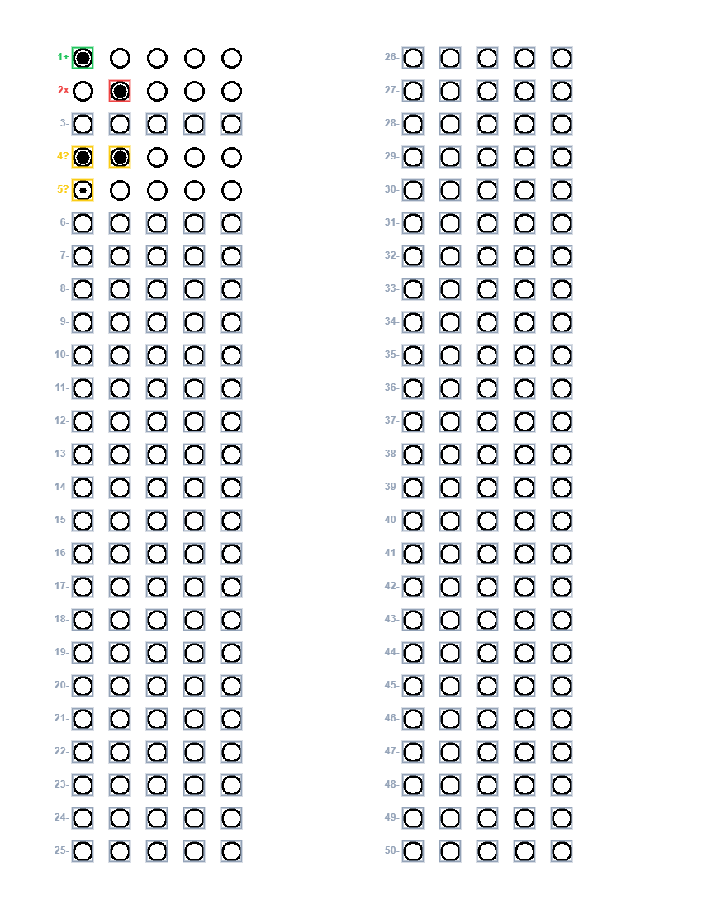

# Issue 07 — Alunos e correção visual

A interface mantém o estilo atual e passa a ter somente **Avaliações**,
**Correção** e **Alunos**. Não há dashboard, gráficos, turmas ou relatórios.
O motor `app/services/correcao.py` e os limiares de reconhecimento não foram
alterados. Não houve acesso ou modificação de dados do Firestore real.

## Arquivos desta issue

- Criados: `Backend/app/services/correcao_visual.py`,
  `Backend/tests/test_alunos.py`, `Backend/tests/test_correcao_visual.py`,
  `Frontend/js/alunos.mjs`, `Frontend/js/correcao-visual.mjs`,
  `Frontend/tests/correcao-visual.test.mjs`, este documento e
  `docs/exemplos/correcao-visual.png`.
- Modificados: `Backend/app/services/persistencia.py`,
  `Backend/app/routes/interface.py`, `Backend/app/routes/correcoes.py`,
  `Frontend/index.html`, `Frontend/css/style.css`, `Frontend/js/app.mjs`,
  `Frontend/tests/browser.test.cjs` e as seções pertinentes do `README.md`.

No ajuste de cadastro automático também foram alterados `Frontend/js/api.mjs`,
`Backend/tests/test_api_interface.py` e o banco simulado de
`Backend/tests/test_persistencia.py`; os novos testes estão em
`Backend/tests/test_aluno_automatico.py`.

## Coleção `alunos`

Cada documento contém:

```text
id: identificador estável (SHA-256 para primeiro cadastro automático; UUID para homônimo explicitamente confirmado)
nome: nome informado, com espaços normalizados e Unicode NFC
nome_normalizado: nome com casefold, preservando acentos
criado_em: datetime UTC
```

O serviço rejeita nome vazio, sem letras ou com mais de 200 caracteres.
Nomes iguais após normalizar espaços, maiúsculas/minúsculas e composição
Unicode reutilizam um único cadastro quando não há ambiguidade. A operação
Firestore `create` no ID determinístico impede duplicações concorrentes
no cadastro automático. Cadastros existentes mantêm seus IDs. O ID é
estável, mas não é uma credencial ou um segredo.

Busca e ordenação usam comparação sem acentos e sem diferença entre
maiúsculas/minúsculas. A busca é por trecho. A ordenação alfabética usa essa
chave e o ID como desempate, sem depender da collation do Firestore.

Nomes semelhantes são sugestões calculadas por `SequenceMatcher`, com
similaridade mínima de 0,82. Variações de acentuação podem aparecer como
semelhantes; não são tratadas como a mesma pessoa automaticamente.
O limiar é heurístico e não identifica homônimos ou identidade civil.

## Cadastro automático no salvamento confirmado

O OCR continua preenchendo uma sugestão editável. Após OCR ou digitação,
a interface pode consultar correspondências, mas não cria alunos. Não há
formulário nem botão de cadastro na aba Alunos ou na Correção. O usuário
pode processar o cartão informando apenas a avaliação e o nome conferido.

Somente ao confirmar **Salvar correção**, o servidor:

1. Valida o resultado, a aceitação de pendências e a existência da avaliação.
2. Busca correspondências exatas do nome normalizado, sem usar nomes semelhantes.
3. Reutiliza o ID se há exatamente um aluno correspondente.
4. Se não há correspondente, prepara um cadastro com ID determinístico.
5. Grava a correção e, quando necessário, o aluno no mesmo lote atômico.

Se outro salvamento criou o mesmo aluno antes do commit, o lote falha inteiro
por `AlreadyExists`; o serviço reconsulta o cadastro e reutiliza o ID em uma
nova tentativa. Não existe etapa de criação isolada que deixe um aluno órfão
quando a gravação da correção falha. A lista da aba Alunos é atualizada após
o salvamento, respeitando a pesquisa atual.

Editar o nome invalida o resultado anterior. O OCR, a seleção do arquivo e a
correção sem salvamento confirmado não criam documentos de alunos.

### Pessoas diferentes com o mesmo nome

Se há mais de um cadastro exato, o servidor retorna HTTP 409 com
`detail.codigo=aluno_ambiguo`, sem gravar nada. A interface mantém a correção
visível, desmarca a confirmação e permite selecionar o ID correto. Os IDs
curtos são exibidos na consulta/lista para distinguir cadastros com mesmo nome.

Mesmo quando só há um aluno exato, o usuário pode marcar explicitamente
**Confirmo que é outra pessoa com o mesmo nome**. Ao salvar, isso cria um
cadastro separado com UUID (`novo_homonimo=true`). Escolher um ID e pedir novo
homônimo simultaneamente é rejeitado. Não há associação por semelhança.
Uma escolha de homônimo exige confirmar o salvamento novamente, mas não
obriga a reconhecer a prova de novo, pois não muda as respostas.

## Associação e registros antigos

`salvar_correcao` aceita o parâmetro opcional `aluno_id`. Quando fornecido,
o aluno precisa existir e seu nome deve corresponder ao cadastro. O documento
de correção armazena tanto `aluno_id` quanto o nome canônico em `aluno`.
As pontuações e contagens do motor são preservadas.

Clientes podem continuar enviando a correção apenas com nome: a API agora
resolve ou cria o ID automaticamente no salvamento confirmado. A função de
baixo nível mantém seu comportamento legado por padrão; a rota ativa
`vincular_aluno=True`. Isso preserva consultas e testes de registros antigos.
Nenhum registro antigo é atualizado automaticamente. O histórico distingue:

- **Vinculadas ao cadastro**: documento com o ID exato do aluno selecionado.
- **Antigas com mesmo nome — sem vínculo por ID**: documento sem `aluno_id`
  cujo nome normalizado coincide. Essa é uma consulta por nome, não uma
  associação comprovada; homônimos podem exigir revisão externa.

Correções associadas a outro ID não entram no histórico por semelhança ou
igualdade textual. A avaliação é apresentada pelo título atual da prova; se
não existir mais, é mostrado seu ID. O histórico exibe pontos, percentual,
data e situação, em ordem de processamento decrescente.

## Endpoints

Todos os endpoints de alunos e histórico usam a dependência de persistência
existente, preservando `FIRESTORE_MODO=real`, o emulador padrão e as restrições
locais do modo real. Não foram adicionadas credenciais ao frontend.

| Método e rota | Entrada / saída |
| --- | --- |
| `GET /api/alunos?busca=...` | Lista alfabética de alunos, opcionalmente filtrada por trecho |
| `GET /api/alunos/correspondencias?nome=...` | `{exato: aluno ou null, exatos: [...], semelhantes: [...]}`; somente consulta |
| `GET /api/alunos/{id}/correcoes` | `{aluno, correcoes, legadas_por_nome}`; 404 se aluno não existe |
| `POST /api/correcoes/processar` | Rota existente; `visual=true` opcional em multipart habilita resposta visual |
| `POST /api/correcoes/recalcular` | JSON `{respostas, gabarito}` → motor recalculado e marcações por questão, sem persistência |
| `POST /api/correcoes/salvar` | Cria/reutiliza aluno e salva correção após confirmação; aceita `aluno_id` para desambiguação ou `novo_homonimo=true` para outra pessoa |

`/api/alunos/reconhecer-nome` continua sendo a rota OCR existente e não é
confundida com consulta por ID. O antigo `POST /api/alunos` foi removido (405);
não há rota pública de cadastro manual, atualização ou exclusão de alunos.

## Imagem anotada

Com `visual=false` (padrão), o processamento retorna exatamente o resultado
anterior do motor. Com `visual=true`, retorna:

```text
resultado: saída intacta do motor
respostas: 50 leituras no formato do reconhecimento
marcacoes: por questão, estado visual e alternativas candidatas
visualizacao:
  imagem: PNG base64 da imagem efetivamente processada, ainda sem anotações
  largura / altura: dimensões desse PNG
  posicoes: caixas A–E por questão, com x/y/largura/altura em pixels
  mensagem: orientação de conferência ou aviso de fallback textual
```

`correcao_visual.py` reutiliza `identificar_tabelas` ou `identificar_grade`
do OpenCV. As caixas são as células reais detectadas ou os limites dos círculos;
não há coordenadas fixas de questões. Quando há captura com retificação, tanto
o reconhecimento quanto a geometria usam a mesma imagem retificada. O PNG
retornado também representa essa imagem, evitando desenhar coordenadas de
perspectiva corrigida sobre a fotografia original.

O navegador desenha a imagem e os contornos em um canvas novo, usando a
resolução original do PNG. O CSS redimensiona imagem e sobreposição juntos.
O arquivo enviado e os pixels da imagem-base não são modificados.

| Estado | Cor | Identificação adicional |
| --- | --- | --- |
| Correta | Verde `#22c55e` | Número e `+` |
| Incorreta | Vermelho `#ef4444` | Número e `x` |
| Múltipla ou duvidosa | Amarelo `#facc15` | Número e `?` |
| Em branco | Cinza `#94a3b8` | Número e `-` |

Para marcações, são destacadas as candidatas; para branco, a linha de alternativas
é contornada em cinza. Pendências nunca são classificadas como corretas pelo
simples fato de incluírem a alternativa oficial entre candidatas.

Sem geometria confiável, a imagem não é anotada e há aviso para usar o resultado
textual. O canvas também ignora posições ausentes, inválidas ou fora da imagem;
nesse caso informa quantas questões possuem localização segura.

### Conferência manual

A lista de 50 questões oferece a leitura original, A–E ou **Em branco**.
Escolher uma resposta é uma decisão manual explícita. A opção original restaura
inclusive múltiplas/duvidosas, sem escolher uma candidata por conta própria.

Cada alteração chama `/api/correcoes/recalcular`, reutilizando o motor original.
Após sucesso, pontuação e contornos são atualizados e as confirmações de
salvamento/provisoriedade são desmarcadas. Durante o recálculo o salvamento
fica bloqueado. Se falhar, a seleção volta ao último estado aceito e não se
aplica uma nova nota visual sem validação do servidor.

Não são salvos PNG, foto, base64, posições ou canvas no Firestore. Somente o
resultado confirmado e a associação do aluno são enviados à persistência.

## Exemplo

Imagem produzida pelo canvas real da interface, usando cartão sintético:



Questão 1 correta, 2 incorreta, 3 em branco, 4 múltipla e 5 duvidosa. As demais
estão em branco. O gabarito fictício dessa demonstração é A em todas as questões;
não é gabarito oficial de uma prova real. A imagem é um artefato documental
sintético, não uma fotografia de aluno armazenada pela aplicação.

## Validação

```powershell
cd Backend
.\.venv\Scripts\python.exe -m pytest -q
cd ..
node --test Frontend/tests/*.test.mjs
```

O cenário de navegador usa a configuração Playwright descrita em
`interface-web.md`, backend ativo e dependências de persistência simuladas.
Além dos arquivos sintéticos anteriores, gere `visual-mista.png` na pasta
`QA_ARTIFACT_DIR`:

```powershell
@'
import os, sys
from pathlib import Path
import cv2
sys.path.insert(0, str(Path('Backend').resolve()))
sys.path.insert(0, str(Path('Backend/tests').resolve()))
from test_reconhecimento import cartao
imagem = cartao({(1,0): 'cheia', (2,1): 'cheia', (4,0): 'cheia',
                 (4,1): 'cheia', (5,0): 'parcial'})
cv2.imwrite(str(Path(os.environ['QA_ARTIFACT_DIR'])/'visual-mista.png'), imagem)
'@ | .\Backend\.venv\Scripts\python.exe -
node --test Frontend/tests/browser.test.cjs
```

Os testes cobrem cadastro, busca sem acentos, ordem alfabética, duplicidade,
semelhanças, associação por ID, nomes incompatíveis, aluno inexistente,
histórico legado sem migração, validação HTTP e bloqueio de acesso remoto no
modo real. Os testes visuais verificam cores no canvas, símbolos/números,
caixas em posição conhecida, imagem-base preservada, geometria de ambos os
PDFs locais, alinhamento após retificação e fallback sem coordenadas.

O Chrome exercita as três abas, cadastro somente no salvamento confirmado,
reutilização automática exata, pesquisa/histórico, confirmação de homônimos,
processamento real no backend, cores efetivas
nos pixels, revisão manual e reconfirmação. O Firestore é simulado nesses
testes; nenhum acesso ou escrita reais são realizados. Os testes anteriores
de câmera, OCR, correção e isolamento do Firebase foram preservados.

Resultado após o ajuste: **208 aprovados, 1 ignorado e 0 reprovados no
Pytest**, **15 testes JavaScript aprovados** e **5 cenários Chrome aprovados**.
O teste ignorado exige Firestore Emulator; permanece um aviso preexistente
do Starlette/TestClient. Não houve conexão com Firestore real.

## Limitações e pendências

- Nomes não comprovam identidade: o usuário distingue homônimos conferindo
  IDs e histórico e pode confirmar um cadastro separado. Sem matrícula ou
  outro identificador não é possível descobrir automaticamente que duas
  pessoas têm o mesmo nome. IDs são imutáveis; não há
  renomeação, fusão, exclusão, turmas ou matrícula nesta issue.
- Listagem, semelhanças e histórico carregam coleções para filtrar/ordenar no
  backend. Isso atende o volume inicial, mas exigirá paginação/índices para
  crescer. Leituras reais podem gerar custos.
- Correções antigas por nome são apresentadas separadamente; nenhuma identidade
  é deduzida ou migrada. Um nome igual não comprova ser a mesma pessoa.
- A persistência armazena o resultado final, mas ainda não possui auditoria de
  cada edição manual nem histórico das imagens ou das alternativas revisadas.
- O modelo ainda depende da qualidade do reconhecimento. Geometria detectada
  não garante intenção da marcação. A detecção rejeita modelos incompatíveis.
- PDFs reais foram usados para validar geometria. Não houve teste físico de
  webcam USB nem teste ponta a ponta com Firestore Emulator nesta entrega.
  O teste do emulador permanece ignorado quando não configurado.
- Não há autenticação/autorização. Use somente a API local, como descrito em
  `firebase.md`; os bloqueios de produção nos testes foram mantidos.
- Não há idempotência de correção: depois de uma resposta de rede inconclusiva,
  confira o histórico antes de repetir. A confirmação de outra pessoa homônima
  é uma decisão explícita de criar identidade distinta; repetir essa opção em
  novos salvamentos cria novos cadastros, não uma dedução de identidade.

Implementação encerrada na Issue 07, sem commit, merge, push ou início da próxima.
